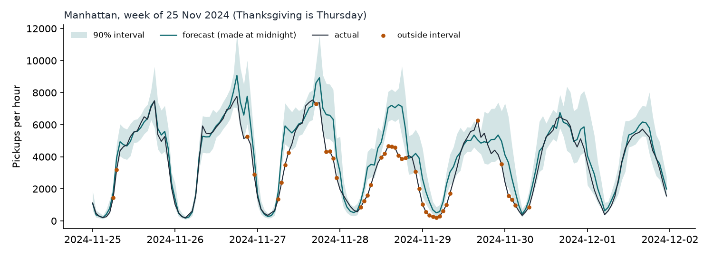

# Taxi Demand Forecast

How many yellow-taxi pickups will each NYC borough see in each hour tomorrow? This project makes that forecast every midnight for Manhattan, Queens, Brooklyn, and the Bronx, using **41 million real 2024 trips**. It is tested the way a forecast has to be:
- a rolling-origin backtest that only ever trains on the past;
- simple baselines the model must beat;
- a period for choosing the model, and a separate period for reporting it;
- 90% prediction intervals whose coverage is checked, including by time of day.

> **Status: learning project (September 2026).** It is built, tested, and run on real data, but I am still practising explaining it. The forecasts cover **yellow taxis only**, one year (2024), and a next-day horizon.



## Headline results (evaluation period Oct–Dec 2024, used for no decision)

| | Error (WAPE) | vs "same hour last week" |
|---|---:|---:|
| **Gradient boosting, Poisson loss** | **10.8%** | **38% lower error** |
| Same hour, mean of last 4 weeks | 14.2% | 18% lower |
| Same hour last week (the baseline) | 17.4% | — |
| Same hour yesterday | 19.6% | 13% higher |

- The model beats every baseline **in every borough**. Manhattan's error is 10.0%. The Bronx is hardest at 35.0%, because an hour there averages 16 trips, so a miss of a few trips is a large percentage.
- **Holidays are where it fails.** The average daily error is 10.3% on ordinary days but 33.7% on the four federal holidays in the period. Christmas Day was over-forecast by 52% (82,643 forecast vs 54,505 actual). The model had seen no holiday like Thanksgiving or Christmas in its training data.
- **The 90% intervals covered 88.8% of actual hours.** They cover 88–90% in every borough *and* at every time of day, but only after a fix, described below.

## A mistake this project caught in itself

The first intervals used one width per borough. Overall coverage looked fine (88.6%), but it was **76% overnight and 98% at midday**: too narrow at night, too wide in the afternoon, and right only on average. Setting the width separately for each borough and 6-hour block of the day ("Mondrian" conformal) brought every block to 88–90%.

In fairness: I first noticed this in the evaluation results. I then confirmed that the same problem was visible in the selection period (80% overnight there), chose the fix on the selection data, and reported both versions on evaluation. The evaluation period was not used to tune the fix, but it was not unseen when I looked for problems.

## Quickstart

```bash
cd taxi-demand-forecast
python3 -m venv .venv && source .venv/bin/activate
python -m pip install -e '.[dev]'

python -m pytest -q tests          # 15 tests, offline (~10 s)

taxiforecast download              # 12 monthly 2024 files + zone lookup, SHA-256 verified (~700 MB)
taxiforecast run                   # select on Jul-Sep, evaluate on Oct-Dec, intervals -> outputs/ (~4 min)
```

Details: [docs/results.md](docs/results.md) and [docs/how-it-works.md](docs/how-it-works.md).

## Data

[NYC TLC Trip Record Data](https://www.nyc.gov/site/tlc/about/tlc-trip-record-data.page), yellow taxi, January–December 2024, plus the taxi zone lookup. Pickups are counted per hour for the four boroughs with meaningful volume. Staten Island and Newark Airport average under one trip an hour.
