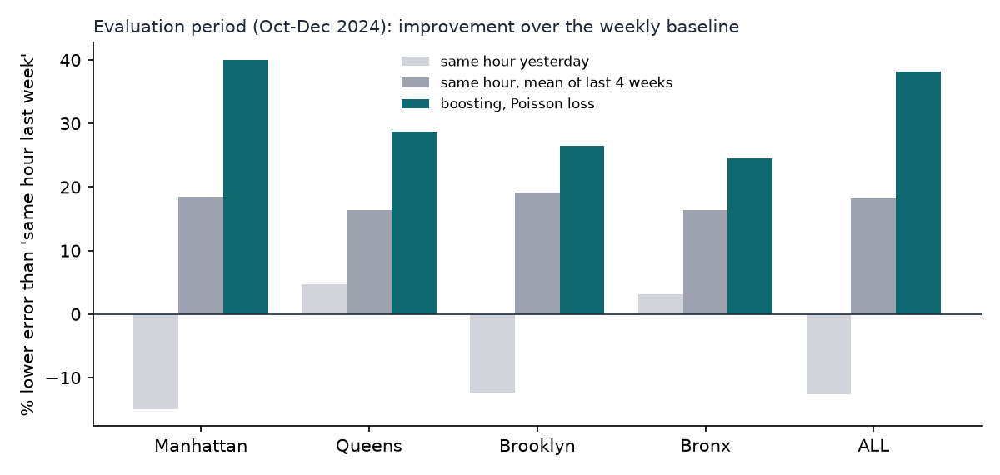
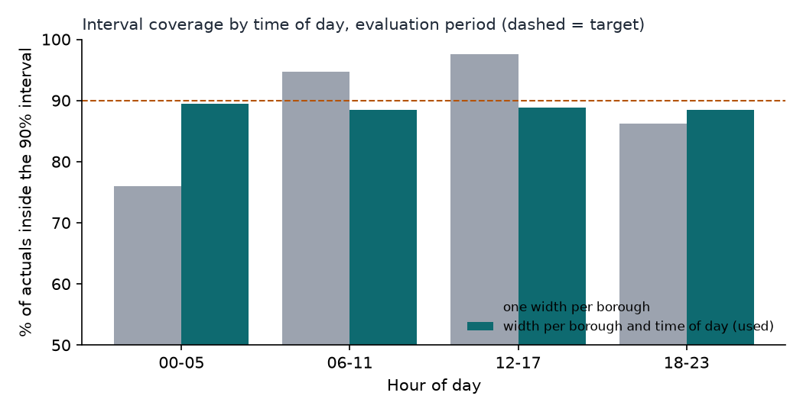
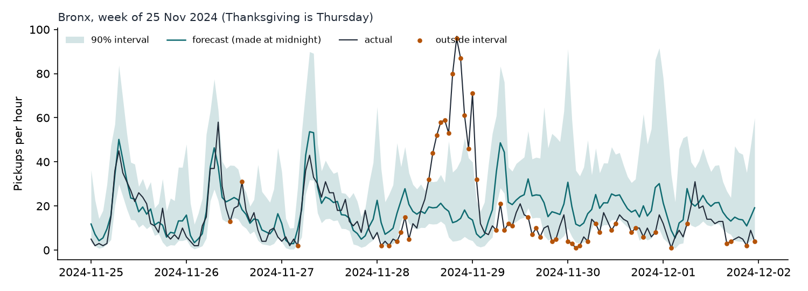

# Results — run of 2026-09-22

Every number is produced by `taxiforecast run` on the checksum-verified 2024 files. The models use a fixed seed, so re-running reproduces these numbers.

## 1. The series

There are 8,783 hours in 2024, not 8,784, because 2 am on 10 March never existed (spring forward). There are four boroughs and 40,978,273 counted pickups.

| Borough | Mean pickups per hour (2024) |
|---|---:|
| Manhattan | ≈ 4,140 |
| Queens (mostly JFK and LaGuardia) | ≈ 442 |
| Brooklyn | ≈ 68 |
| Bronx | ≈ 14 |

Hours with no pickup are real zeros and are kept. 1 am on 3 November happened twice (fall back), so that hour's count is two hours of trips. It is never used as a training target, a score, or a lag.

## 2. Selection period (Jul 1 – Sep 29, 13 weekly folds)

| Forecast | WAPE | MAE (trips/hour) | vs last week |
|---|---:|---:|---:|
| **Boosting, Poisson loss** | **13.74%** | 150.1 | +15.8% |
| Boosting, squared loss on log counts | 14.61% | 159.6 | +10.4% |
| Same hour last week | 16.32% | 178.2 | — |
| Same hour, mean of last 4 weeks | 16.84% | 183.9 | −3.2% |
| Same hour yesterday | 19.96% | 217.9 | −22.3% |

The rule, fixed before running: pick the variant with the lowest overall WAPE. That was the Poisson loss. A plausible reason it won: Poisson models counts directly, so the model's average forecast matches the average count. The squared-on-log variant targets something closer to a geometric mean, which under-forecasts large, variable hours. Manhattan, where the counts are largest, is where Poisson's lead is widest (13.4% vs 14.4%). The log variant was actually slightly better in the two smallest boroughs (Bronx 31.5% vs 32.0%, Brooklyn 25.9% vs 26.5%). Poisson won overall because WAPE across all boroughs is dominated by Manhattan's volume.

## 3. Evaluation period (Sep 30 – Dec 29, 13 weekly folds, used for no decision)

WAPE by borough:

| Borough | Boosting (Poisson) | Mean of last 4 weeks | Last week | Yesterday |
|---|---:|---:|---:|---:|
| Manhattan | **10.0%** | 13.6% | 16.6% | 19.1% |
| Queens | **14.4%** | 16.9% | 20.2% | 19.3% |
| Brooklyn | **26.5%** | 29.1% | 36.0% | 40.4% |
| Bronx | **35.0%** | 38.8% | 46.3% | 44.9% |
| **All** | **10.8%** | 14.2% | 17.4% | 19.6% |

Why the model's advantage is larger here (38%) than in the selection period (16%), as a likely explanation I have not tested separately: October–December contains Thanksgiving and Christmas, and the "last week" baseline is hurt twice by each. It misses the holiday itself, and then it forecasts the week after using the holiday as its example. The boosting model uses four weeks of history and a 7-day level, so it recovers faster. Holidays hurt the model too (section 5), just less.

## 4. Prediction intervals (90% target)

These are online split-conformal intervals on the log scale. The half-width is the finite-sample-corrected 90% quantile of the previous 28 days' out-of-sample errors. The conformal windows warm up on the selection period, so every evaluation hour has an interval.

| | One width per borough (first version) | Width per borough × 6-hour block (used) |
|---|---:|---:|
| **Overall** | 88.6% | **88.8%** |
| 00–05 | 76.0% | **89.5%** |
| 06–11 | 94.6% | **88.5%** |
| 12–17 | 97.6% | **88.8%** |
| 18–23 | 86.2% | **88.4%** |

By borough (method used): Bronx 89.6%, Manhattan 88.7%, Brooklyn 88.6%, Queens 88.2%.

**How the fix was found.** I spotted the overnight under-coverage in the evaluation output. Before changing anything, I checked the selection period, and the pattern was there too: 80% overnight, 97% midday. The fix was chosen there, where it brought every block to 89.7–90.9%. The evaluation numbers above are the first time the fixed method met that data. Still, the evaluation period was not unseen when I went looking for problems, and that is why both versions are reported.

**Why coverage is about a point short of 90%.** Conformal intervals guarantee coverage when errors are *exchangeable*, meaning the recent past looks like the present. Holidays break that, since their errors are larger than anything in the previous 28 days. The misses cluster there, as the Thanksgiving chart shows.

## 5. Where it fails

| Day type (evaluation) | Days | Mean daily WAPE |
|---|---:|---:|
| Ordinary | 83 | 10.3% |
| Day after a federal holiday | 4 | 16.6% |
| **Federal holiday** | 4 | **33.7%** |

The worst days, as total forecast vs actual:

| Day | Actual | Forecast | WAPE | Note |
|---|---:|---:|---:|---|
| 25 Dec | 54,505 | 82,643 | 54.2% | Christmas |
| 28 Nov | 76,905 | 105,482 | 44.5% | Thanksgiving |
| 24 Dec | 80,432 | 112,962 | 42.2% | Christmas Eve, not a federal holiday, so the model had no flag |
| 5 Nov | 97,111 | 123,149 | 27.2% | Election Day, not flagged |
| 26 Dec | 74,457 | 91,360 | 25.3% | Day after Christmas |

The holiday flag is learned from January–September holidays (New Year's Day, MLK Day, Memorial Day, the Fourth of July, and so on). Those don't behave like Thanksgiving or Christmas, and one year of data contains exactly one of each. The fix would be more years of data, or holiday-specific features, and neither is attempted here.

## Known limits

- One year of data, so the model never sees the same season twice. Month-of-year is deliberately not a feature, because October would be a category it has never trained on.
- A next-day horizon only. Same-day updating (for example at noon for the evening) would be more accurate, and is not built.
- Yellow taxis only. Borough-level demand, not zone-level.
- Interval coverage is slightly under target, and worst on holidays.
